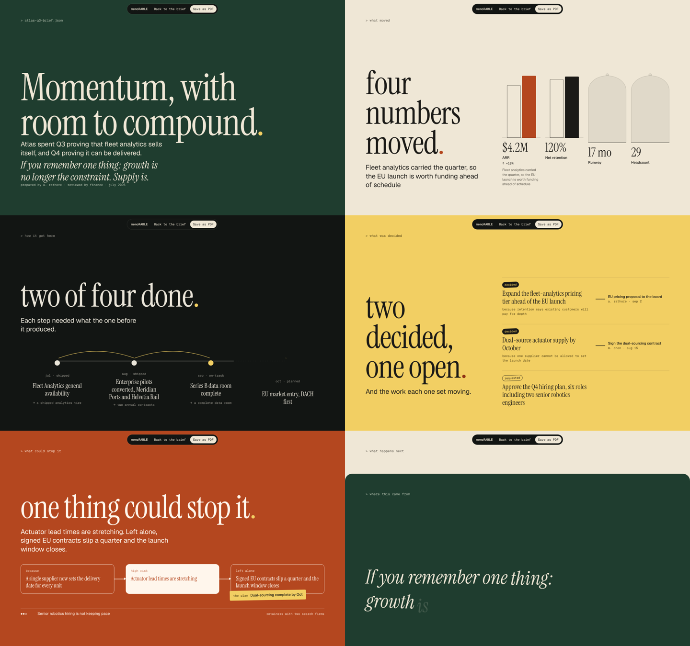
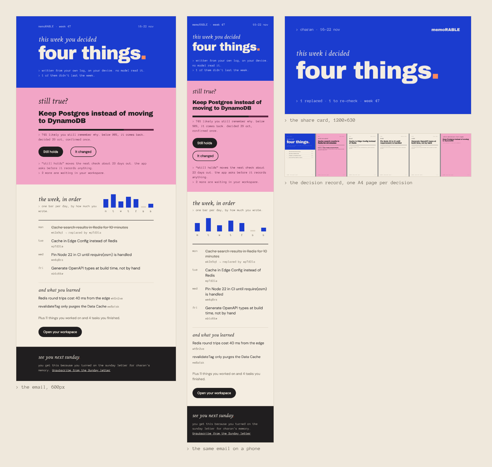

# memoRABLE

**Engineering memory that knows when it's out of date.**

Write down what you worked on, learned and decided. Find it again when it matters. Before you forget *why* a decision holds, it comes back and asks whether it still does. It runs in your browser with no server and no model in the loop.

[**Try the live workspace**](https://memo-rable.vercel.app/#workspace) · [Real search demo](https://memo-rable.vercel.app/#proof) · [Sample brief](https://memo-rable.vercel.app/#briefs) · [Daily system architecture](docs/architecture/DAILY_SYSTEM.md) · [Code graph](docs/codegraph/README.md)

Follow the numbers. **1–2**: you write, and it is appended to an event log, never edited in place. **3–7**: every view is a replay of that log. **8**: decisions come back before the reasoning fades. **A–C** are optional: GitHub issues, a local embedding model, and document briefs.

## The problem

Teams remember *what* they decided and forget *why*. When the why is gone, the decision gets reopened, sometimes months later, by someone who reaches the same conclusion the hard way. The usual fix is decision records, and they have their own well-known failure: nobody rereads them. A record of a decision you've since reversed is worse than no record, because it still reads as authoritative.

So memoRABLE treats memory as something that **decays and must be maintained**, not a pile of notes:

- **Every change is an event.** Revisions, status changes, replacements and deletions are appended, so any view can be rebuilt and audited.
- **Replaced decisions are marked as replaced.** Recall demotes them and shows the replacement first.
- **Decisions and lessons come back.** Each one carries a memory model, so it returns when you're likely to have forgotten the reasoning.
- **You can ask what was in force on any date.** The log answers it directly.

## Four loops, one log

| Loop | What happens | How |
|---|---|---|
| **Capture** | Write a note, link earlier entries with `#handle`, or replace a decision outright | Append-only events in IndexedDB; delete redacts stored text ([`engine.ts`](src/daily/engine.ts)) |
| **Recall** | Search notes plus connected GitHub issues and PRs | BM25F over title, body, labels and error signature, plus optional on-device `bge-small` vectors ([`src/search`](src/search/)) |
| **Next** | One suggested task, with a readable reason for every point of its score | A deterministic planner, not a model ([`planner.ts`](src/daily/planner.ts)) |
| **Still true?** | Decisions and lessons return when predicted recall drops below 90%: *Still holds* · *Not sure* · *Changed* | FSRS-5 memory model; *Changed* reopens the decision ([`fsrs.ts`](src/daily/fsrs.ts)) |
| **Look back** | Pick a date to see the decisions in force then and what replaced them since | Replay of the log up to that date; deletions still win ([`projection.ts`](src/daily/projection.ts)) |

```mermaid
stateDiagram-v2
  direction LR
  [*] --> Recorded: write
  Recorded --> Due: predicted recall < 90%
  Due --> Recorded: Still holds (stability grows; next check moves out)
  Due --> Due_soon: Not sure (smaller growth, harder)
  Due_soon --> Recorded: later check
  Due --> Reopened: Changed (status unresolved)
  Reopened --> Superseded: write what replaces it
  Superseded --> [*]: findable, demoted, never resurfaced
```

## Search, measured on real duplicate issues

A frozen [benchmark](bench/search/) of **179 duplicate-issue queries** from VS Code and Next.js. Each query may only retrieve issues created before it, and the right answer is the earlier issue that maintainers linked.

| Retrieval arm | Whole-issue Recall@10 | Title-only Recall@10 |
| --- | ---: | ---: |
| Plain BM25 | 72.6% | 88.3% |
| Fielded BM25F | 83.2% | 88.3% |
| bge-small-en-v1.5, quantized, dense | **96.6%** | 93.3% |
| Hybrid weighted fusion (bge-small + keyword) | 95.0% | **91.6%** |

- **int8 vectors** lost no measurable ranking quality against float32 (nDCG@10 0.876 vs 0.877).
- **Exact search was fast enough** on a 2,540-item exact scan, so no ANN index is used.
- **Error fingerprints and the synonym lexicon** made no meaningful difference, and the [search architecture](docs/search/ARCHITECTURE.md) says so, with confidence intervals.

These are retrieval scores on this dataset, not answer correctness.

## Research behind it

| Paper | What we took | Where |
|---|---|---|
| FSRS / DSR model (Ye, Su & Cao, [KDD 2022](https://dl.acm.org/doi/10.1145/3534678.3539081)) | Power forgetting curve `R = (1 + 19/81·t/S)^-0.5`; stability and difficulty updates per answer | [`fsrs.ts`](src/daily/fsrs.ts), FSRS-5 default weights |
| [Zep / Graphiti](https://arxiv.org/abs/2501.13956) (2025) | Facts carry validity windows and are invalidated rather than overwritten | Supersession time on entries; `asOf(date)` replay |
| BM25F (Robertson, Zaragoza & Taylor, 2004) and BM25Fext (Sun et al., ASE 2011) | Field weights, saturation of long-query term frequency | [`bm25f.ts`](src/search/bm25f.ts) |
| Reciprocal Rank Fusion (Cormack et al., SIGIR 2009) | Hybrid fusion baseline | [`fusion.ts`](src/search/fusion.ts) |

FSRS-5's default weights were fitted on flashcard reviews, not engineering decisions. They give a principled, explainable schedule that expands from days to weeks to months. They are not a validated model of how fast a decision's rationale decays.

## A second workflow: document → brief

Import a PDF, Markdown, plain-text or memoRABLE JSON source. A conservative local parser produces six inspectable, source-linked memory blocks, rendered as editable email, web and document outputs with Unlayer Elements.

- JSON import is strict and all-or-nothing.
- PDFs are read with pdf.js, with selective OCR and visible warnings, up to 2 MB and the first 40 pages.
- AI is optional and is never used for capture or recall.

[Try a brief](https://memo-rable.vercel.app/#briefs).

## A document, as a story

Import any brief, report or set of notes, then choose **Play as a story**. The six memories the importer found become a page you scroll through, one idea per screen. Each beat gets the chart its data supports: what moved, how it got here, what was decided and what it set moving, what could stop it, and what happens next. **Save as PDF** gives one finished page per beat ([example](docs/media/atlas-story.pdf)).

The taste is written down as rules and tested, so every document gets the same care:

- **One idea per screen.**
- **Only the document's own words and numbers.** A value it can't read as a number is shown as words.
- **Never two units on one axis.** Each measure is drawn on its own scale from zero.
- **A chart only when it says more than a sentence.**

**Research papers read as papers.** I tested four real Google Research papers (PDFs from [google-research/google-research](https://github.com/google-research/google-research)): Streaming Parrotron, Jpegli, Near-Quadratic Sample Compression, and Gradient Based Pruning.

Before this change:
- Two of them opened with their file name.
- One opened with its author list as the summary.
- Streaming Parrotron wasn't recognised as a paper at all, because its References sit past the first 80 lines.
- "int4" and "the 1980s" were shown as measured results, and a paper's findings never reached the story.

Now:
- A paper is told as *what it found*, then *what it measured*, then *where it stops*.
- The title is read from the page.
- The opening line is the authors' own headline result. For Streaming Parrotron that's "≈2x faster than real time on the Pixel4 CPU".
- Subsections inherit their section, so "Cifar10" under Results counts as results.
- Extracted math notation is never quoted as a finding.

The rules live in [`src/story/plan.ts`](src/story/plan.ts), the motion in [`src/story/motion.ts`](src/story/motion.ts), and the reasoning in [`src/story/DESIGN.md`](src/story/DESIGN.md). [Open it](https://memo-rable.vercel.app/story), or watch [the recording](docs/media/story.mp4).

## The Sunday letter

Once a week, the log reads itself back to you: what you decided, what didn't last the week, and the one decision whose reasons you are most likely to have forgotten (FSRS-5 predicted recall below 90%). It is one design written with [Hyper Elements](https://hyperelements.dev) templates and rendered four ways from the same values:

| Template | Root | Output |
|---|---|---|
| `memorable.WeekLetter` | `Email` | table-based HTML for Gmail and Outlook, plus plain text |
| `memorable.WeekPage` | `Page` | a responsive web page with SVG charts |
| `memorable.DecisionRecord` | `Document` | an A4 PDF, one page per decision |
| `memorable.WeekCard` | `Canvas` | a PNG to share (1200×630 and 1080×1080) |

How Hyper Elements is used:

- **One theme, four roots.** `defineTheme()` in [`src/letter/theme.ts`](src/letter/theme.ts) sets the colours, fonts and named styles once, and all four templates take it.
- **Templates with guardrails.** Each template declares typed fields (`prop.text`, `prop.list`, `prop.choice`…) and rules. The email must pass lint's `unsubscribe`, `link-text`, `lang` and `contrast` checks and `layout/overflow`, and may only link to this app. `check()` holds every example to its rules in CI.
- **Real data in, not a mock.** [`weekLetter()`](src/letter/week.ts) builds the values from the event-sourced log on your device: deleted entries are left out, replaced decisions are struck through, and the recheck comes from the FSRS schedule.
- **Links that can't act on their own.** Link scanners open every link in an email, so "Still holds" only carries the question. The app asks before it records anything.

In the app, open **Review → Write this week's letter**. To write every output from the example week to `out/letter/`, run `npm run letter`. The design rules are in [`src/letter/DESIGN.md`](src/letter/DESIGN.md).

## Develop and verify

Requires Node 20.9–24 ([.nvmrc](.nvmrc) pins 22).

~~~sh
git clone https://github.com/charan-rathore/memoRABLE.git
cd memoRABLE
nvm use && npm ci
npm run dev          # http://localhost:3000
npm run verify       # lint, types, unit tests, production build
npm run test:e2e     # Playwright, desktop and mobile
node scripts/codegraph.mjs . docs/codegraph   # regenerate the code graph
~~~

[`docs/codegraph/`](docs/codegraph/README.md) is a generated dependency map: a layer diagram, the most-imported modules, import cycles and a per-layer file index. Read it before changing a hub module.

## Honest limits

- The search benchmark covers two repositories and 179 queries. It isn't proof of quality on every personal notebook.
- Everything is browser-local: no multi-device sync and no cloud backup. Clearing browser data removes it.
- A GitHub token is held in browser storage unencrypted, so use a narrowly scoped one.
- The planner and the re-confirmation schedule are explicit rules and a published memory model, not neural reasoning.
- "Look back" uses the time something was *recorded*. Validity stated in the text ("from Q3 onward") isn't modelled.
- Deletion removes local text and derived state. It doesn't erase GitHub content, backups or other devices.

## License

MIT — © 2026 Charan Rathore. See [LICENSE](LICENSE).
