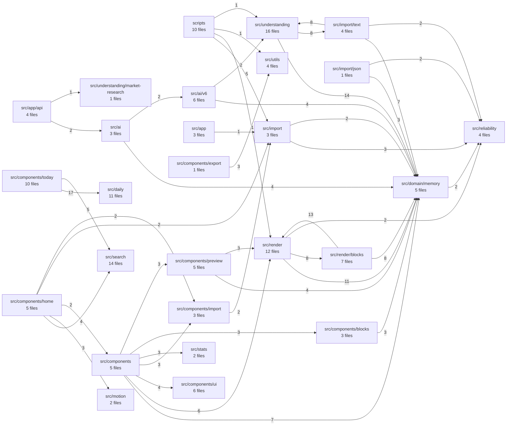

# Code graph

Generated by `node scripts/codegraph.mjs`. Do not edit by hand; regenerate after structural changes.

**308** source files (131 tests) · **707** resolved import edges · **2** import cycles · machine-readable: [graph.json](graph.json)

## Layer map

Arrows point from importer to imported layer; labels count file-level imports (strongest 45 shown).

## Hubs (highest fan-in)

A change here ripples furthest. Test these first.

| File | Imported by | Imports | LOC |
| --- | ---: | ---: | ---: |
| `src/domain/memory/schema.ts` | 73 | 1 | 623 |
| `src/import/import-source.ts` | 60 | 5 | 66 |
| `src/import/examples/catalog.ts` | 22 | 2 | 293 |
| `src/import/text/patterns.ts` | 17 | 2 | 1098 |
| `src/understanding/language.ts` | 16 | 0 | 383 |
| `src/daily/types.ts` | 15 | 1 | 99 |
| `src/render/render-bundle.ts` | 15 | 5 | 102 |
| `src/domain/memory/types.ts` | 14 | 3 | 41 |
| `src/domain/memory/limits.ts` | 13 | 0 | 43 |
| `src/render/themes.ts` | 13 | 1 | 255 |
| `src/search/engine.ts` | 13 | 6 | 176 |
| `src/reliability/diagnostics.ts` | 11 | 0 | 61 |
| `src/render/safe-inline.ts` | 11 | 0 | 51 |
| `src/understanding/inference.ts` | 11 | 6 | 569 |
| `src/understanding/archetype.ts` | 10 | 1 | 255 |

## Import cycles

- `src/import/text/patterns.ts` ↔ `src/import/text/sections.ts` ↔ `src/understanding/inference.ts` ↔ `src/understanding/projection.ts`
- `src/render/build-root.tsx` ↔ `src/render/insight-composition.tsx`

## Unconnected production files

No resolved imports in or out. Entry points (routes, scripts, workers) are expected here; anything else may be dead code.

- `bench/search/build-dataset.mjs`
- `eslint.config.mjs`
- `next.config.ts`
- `playwright.config.ts`
- `scripts/build-demo-memory.mjs`
- `scripts/capture-media.mjs`
- `scripts/codegraph.mjs`
- `scripts/eval-docgraph-compare.mjs`
- `scripts/eval-docgraph-gate.mjs`
- `scripts/fetch-search-model.mjs`
- `scripts/make-demo-video.mjs`
- `scripts/perf/ocr-worker.mjs`
- `src/app/api/docgraph/route.ts`
- `src/app/error.tsx`
- `src/app/layout.tsx`
- `src/components/ui/stagger-title.tsx`
- `vitest.config.ts`

## Index by layer

<b>(root)</b> · 4 files

- `eslint.config.mjs` (in 0 / out 0)
- `next.config.ts` (in 0 / out 0)
- `playwright.config.ts` (in 0 / out 0)
- `vitest.config.ts` (in 0 / out 0)

<b>bench/search</b> · 1 files

- `bench/search/build-dataset.mjs` (in 0 / out 0) — `cleanBody`

<b>scripts</b> · 10 files

- `scripts/build-demo-memory.mjs` (in 0 / out 0)
- `scripts/capture-media.mjs` (in 0 / out 0)
- `scripts/codegraph.mjs` (in 0 / out 0)
- `scripts/eval-docgraph-compare.mjs` (in 0 / out 0)
- `scripts/eval-docgraph-gate.mjs` (in 0 / out 0)
- `scripts/fetch-search-model.mjs` (in 0 / out 0)
- `scripts/gauntlet-export.mts` (in 0 / out 4)
- `scripts/inspect-archetypes.ts` (in 0 / out 2)
- `scripts/inspect-prd.ts` (in 0 / out 2)
- `scripts/make-demo-video.mjs` (in 0 / out 0)

<b>scripts/diagrams</b> · 2 files

- `scripts/diagrams/draw_architecture.py` (in 0 / out 1)
- `scripts/diagrams/sketch.py` (in 1 / out 0) — `Sketch`

<b>scripts/perf</b> · 1 files

- `scripts/perf/ocr-worker.mjs` (in 0 / out 0)

<b>services/docgraph</b> · 4 files

- `services/docgraph/build_graph.py` (in 1 / out 0) — `extract_paper_graph`, `enrich_with_graphify`, `build_knowledge_graph`
- `services/docgraph/cache.py` (in 1 / out 0) — `cache_dir`, `sha256_bytes`, `cache_path`, `load_cached`, `save_cached`
- `services/docgraph/parse_docling.py` (in 1 / out 0) — `parse_with_docling`, `sections_from_markdown`
- `services/docgraph/server.py` (in 0 / out 3) — `MarkdownParseRequest`, `health`, `parse_upload`, `graph_from_markdown`

<b>src/ai</b> · 3 files

- `src/ai/contract.ts` (in 3 / out 2) — `aiExtractRequestSchema`, `aiExtractResponseSchema`, `AiExtractRequest`, `AiExtractResponse`, `AiFailureReason`, `AiFailure`, `AiSuccess`, `AiResult`
- `src/ai/openai-extractor.server.ts` (in 2 / out 5) — `AiCallMeta`, `AiCallOutcome`, `isAiEnabled`, `extractWithAi`
- `src/ai/prompt.ts` (in 1 / out 1) — `LEGACY_IMPROVE_PROMPT`

<b>src/ai/v6</b> · 6 files

- `src/ai/v6/index.ts` (in 3 / out 6) — `CognitivePipelineResult`, `runCognitivePipeline`
- `src/ai/v6/project.ts` (in 1 / out 6) — `ProjectResult`, `projectV6ToMemorySource`
- `src/ai/v6/prompt.ts` (in 2 / out 0) — `V6_SYSTEM_PROMPT`, `buildV6UserPrompt`
- `src/ai/v6/schema.ts` (in 5 / out 0) — `TIMELINE_MODES`, `CONFIDENCE_LEVELS`, `DATE_ROLES`, `SIGNAL_TYPES`, `provenanceSchema`, `v6DocumentMetaSchema`, `v6SnapshotItemSchema`, `v6SignalItemSchema`
- `src/ai/v6/score.ts` (in 1 / out 3) — `scoreMemorySource`, `scoreV6Extraction`
- `src/ai/v6/validate.ts` (in 3 / out 1) — `FailureMode`, `RepairEvent`, `ValidatedV6`, `validateAndRepairV6`, `shouldFallbackToCandidate`, `MemoryQualityScore`

<b>src/app</b> · 3 files

- `src/app/error.tsx` (in 0 / out 0) — `GlobalError`
- `src/app/layout.tsx` (in 0 / out 0) — `metadata`, `viewport`, `RootLayout`
- `src/app/page.tsx` (in 0 / out 4) — `Page`

<b>src/app/api</b> · 4 files

- `src/app/api/docgraph/route.ts` (in 0 / out 0) — `GET`, `POST`, `PUT`
- `src/app/api/extract/route.ts` (in 0 / out 2) — `runtime`, `dynamic`, `GET`, `POST`
- `src/app/api/umbrex-guidance/core.ts` (in 3 / out 1) — `__setUmbrexFetchTimeoutForTests`, `SourceStatus`, `__clearUmbrexGuidanceCacheForTests`, `allowlistedUrls`, `SectionExcerpt`, `SectionExtraction`, `extractSectionExcerpts`, `checkOneSource`
- `src/app/api/umbrex-guidance/route.ts` (in 1 / out 1) — `runtime`, `dynamic`, `GET`

<b>src/components</b> · 5 files

- `src/components/async-operation.ts` (in 4 / out 0) — `createAsyncOperation`
- `src/components/journey-strip.tsx` (in 4 / out 3) — `StepStatus`, `SourceMeta`, `JourneyStep`, `journeyOf`, `JourneyStrip`
- `src/components/topbar.tsx` (in 1 / out 4) — `Topbar`
- `src/components/workbench-state.ts` (in 5 / out 7) — `RenderCacheEntry`, `RENDER_CACHE_SIZE`, `WorkbenchState`, `WorkbenchAction`, `initialWorkbenchState`, `workbenchReducer`, `renderAll`, `displayHtml`
- `src/components/workbench.tsx` (in 4 / out 28) — `WorkbenchInitial`, `Workbench`

<b>src/components/blocks</b> · 3 files

- `src/components/blocks/blocks-panel.tsx` (in 2 / out 2) — `BlocksPanel`
- `src/components/blocks/brief-receipt.tsx` (in 2 / out 3) — `ReceiptCounts`, `receiptFor`, `BriefReceipt`
- `src/components/blocks/inspector.tsx` (in 2 / out 1) — `Inspector`

<b>src/components/export</b> · 1 files

- `src/components/export/publish-panel.tsx` (in 1 / out 6) — `PublishPanel`

<b>src/components/home</b> · 5 files

- `src/components/home/bench-results.ts` (in 2 / out 0) — `BENCH`
- `src/components/home/chapters.tsx` (in 1 / out 4) — `HeroChapter`, `WriteChapter`, `FindChapter`, `NextChapter`, `NumberChapter`
- `src/components/home/hero-recall.tsx` (in 2 / out 3) — `KindGlyph`, `HeroRecall`
- `src/components/home/home-screen.tsx` (in 4 / out 15) — `HomeScreen`
- `src/components/home/story.tsx` (in 1 / out 3) — `SearchProof`

<b>src/components/import</b> · 3 files

- `src/components/import/import-panel.tsx` (in 5 / out 8) — `ImportPanel`
- `src/components/import/import-stages.ts` (in 2 / out 0) — `yieldFrame`, `ImportStage`, `IMPORT_STAGE_LABEL`, `IMPORT_STAGE_VERB`, `IMPORT_STAGE_PERCENT`
- `src/components/import/read-file.ts` (in 4 / out 0) — `FileReadResult`, `ReadProgress`, `ReadOptions`, `readTextFileWithProgress`, `formatBytes`

<b>src/components/preview</b> · 5 files

- `src/components/preview/elements-story.tsx` (in 1 / out 4) — `ElementsStory`
- `src/components/preview/live-guidance-panel.tsx` (in 2 / out 0) — `LiveGuidancePanel`
- `src/components/preview/preview-pane.tsx` (in 1 / out 4) — `PreviewPane`
- `src/components/preview/source-modal.tsx` (in 1 / out 1) — `SourceModal`, `highlightRange`
- `src/components/preview/visual-reading.tsx` (in 2 / out 2) — `VisualReadingPanel`

<b>src/components/replay</b> · 1 files

- `src/components/replay/use-replay.ts` (in 2 / out 1) — `ReplayView`, `useReplay`

<b>src/components/today</b> · 10 files

- `src/components/today/capture-loop.tsx` (in 1 / out 0) — `CaptureLoop`
- `src/components/today/compose.ts` (in 6 / out 2) — `detectKind`, `parseReplaces`, `highlight`, `KIND_LABEL`, `dayKey`, `dayLabel`, `timeOf`, `formatMs`
- `src/components/today/composer.tsx` (in 1 / out 4) — `Composer`
- `src/components/today/entry-stream.tsx` (in 1 / out 4) — `EntryStream`
- `src/components/today/glyph.tsx` (in 4 / out 1) — `Glyph`
- `src/components/today/panels.tsx` (in 1 / out 6) — `NextPanel`, `RecallPanel`, `ReviewPanel`
- `src/components/today/recheck-panel.tsx` (in 1 / out 5) — `StillTruePanel`, `LookBackPanel`
- `src/components/today/today-app.tsx` (in 1 / out 9) — `TodayApp`
- `src/components/today/use-daily.ts` (in 1 / out 3) — `StorageMode`, `useDaily`
- `src/components/today/use-repo-search.ts` (in 7 / out 5) — `ModelState`, `useRepoSearch`

<b>src/components/ui</b> · 6 files

- `src/components/ui/brand-mark.tsx` (in 3 / out 0) — `BrandMark`
- `src/components/ui/brand-splash.tsx` (in 1 / out 1) — `BrandSplash`
- `src/components/ui/demo-video.tsx` (in 1 / out 0) — `DemoVideo`
- `src/components/ui/stage-announcer.tsx` (in 1 / out 0) — `StageAnnouncer`
- `src/components/ui/stagger-title.tsx` (in 0 / out 0) — `StaggerTitle`
- `src/components/ui/unlayer-mark.tsx` (in 1 / out 0) — `UnlayerMark`

<b>src/daily</b> · 11 files

- `src/daily/bench.ts` (in 1 / out 4) — `BenchFixture`, `BenchReport`, `runBench`
- `src/daily/engine.ts` (in 9 / out 7) — `EngineOptions`, `RecallWithLinks`, `ReconfirmAnswer`, `ReconfirmItem`, `DailyEngine`
- `src/daily/fsrs.ts` (in 5 / out 0) — `FSRS5_WEIGHTS`, `FSRS_ID`, `DESIRED_RETENTION`, `Grade`, `MemoryState`, `retrievability`, `intervalDays`, `initialState`
- `src/daily/idb-store.ts` (in 1 / out 2) — `IdbStore`
- `src/daily/lexical.ts` (in 4 / out 0) — `tokenize`, `stem`, `Bm25Config`, `BM25_V1`, `LEXICAL_CONFIG_ID`, `CorpusStats`, `LexicalIndex`
- `src/daily/planner.ts` (in 1 / out 2) — `PlanCandidate`, `PLANNER_ID`, `rankNext`
- `src/daily/projection.ts` (in 4 / out 2) — `RECONFIRM_KINDS`, `inferStatus`, `handleOf`, `emptyState`, `apply`, `project`, `projectAsOf`
- `src/daily/recall.ts` (in 1 / out 2) — `RecallHit`, `RecallResult`, `SUPERSEDED_WEIGHT`, `RECALL_CONFIG_ID`, `recallKey`, `Recall`
- `src/daily/review.ts` (in 2 / out 1) — `OpStats`, `Review`, `percentile`, `review`
- `src/daily/store.ts` (in 6 / out 1) — `EventStore`, `REDACTED`, `redactEvent`, `MemoryStore`
- `src/daily/types.ts` (in 15 / out 1) — `DAILY_SCHEMA`, `EntryKind`, `DecisionStatus`, `TaskState`, `DailyEventBody`, `DailyEvent`, `SourceRef`, `Entry`

<b>src/domain/memory</b> · 5 files

- `src/domain/memory/canonicalize.ts` (in 3 / out 2) — `stableStringify`, `canonicalBlockProjection`, `canonicalDocumentProjection`, `canonicalizeDocument`, `contentHashOf`, `stableBlockId`, `shortHash`
- `src/domain/memory/limits.ts` (in 13 / out 0) — `LIMITS`, `UNSAFE_KEYS`
- `src/domain/memory/normalize.ts` (in 5 / out 3) — `BlockInput`, `DocumentInput`, `buildBlockId`, `finalizeDocument`, `normalizeSource`, `reorderBlocks`
- `src/domain/memory/schema.ts` (in 73 / out 1) — `BLOCK_KINDS`, `blockKindSchema`, `BlockKind`, `PROVENANCE_METHODS`, `provenanceMethodSchema`, `ProvenanceMethod`, `ENTRY_FACETS`, `entryFacetSchema`
- `src/domain/memory/types.ts` (in 14 / out 3) — `OUTPUT_MODES`, `OutputMode`, `OUTPUT_MODE_LABELS`

<b>src/evidence-core</b> · 2 files

- `src/evidence-core/contracts.ts` (in 2 / out 0) — `CONTRACT_VERSION`, `SourceVersion`, `EvidenceLocator`, `ExtractionMethod`, `EvidenceSpan`, `ClaimStatus`, `ClaimAuthor`, `Claim`
- `src/evidence-core/memorable-adapter.ts` (in 2 / out 3) — `BriefEvidenceContext`, `sourceVersionFor`, `recoverLeadingPassage`, `briefToEvidencePackage`, `claimsNeedingJudgment`

<b>src/import</b> · 3 files

- `src/import/import-source.ts` (in 60 / out 5) — `ImportSourceInput`, `ImportMethod`, `importSource`, `detectFormat`, `sanitizeLabel`, `importSourceOrNull`
- `src/import/preflight.ts` (in 3 / out 3) — `PreflightedInput`, `preflightInput`, `checkJsonSafety`, `joinPath`, `lineColumnOf`, `formatBytes`
- `src/import/read-pdf.ts` (in 6 / out 1) — `isPdfFile`, `readPdfFile`, `readPdfBuffer`, `pdfTruncationNote`

<b>src/import/docgraph</b> · 6 files

- `src/import/docgraph/client.ts` (in 5 / out 3) — `probeDocGraph`, `ParseDocGraphOptions`, `parseWithDocGraph`, `graphFromMarkdown`
- `src/import/docgraph/index.ts` (in 2 / out 4)
- `src/import/docgraph/progressive-pdf.ts` (in 3 / out 4) — `ProgressivePdfQuick`, `readPdfQuick`, `ocrProvenanceNote`, `hasReadablePdfText`, `composePdfReadNote`, `refinedReadNote`, `scheduleDoclingRefine`
- `src/import/docgraph/result-cache.ts` (in 2 / out 0) — `ResultCache`
- `src/import/docgraph/select.ts` (in 4 / out 0) — `isDocgraphEnabled`, `DoclingSelectInput`, `shouldRefineWithDocling`, `isDoclingRefinementBetter`
- `src/import/docgraph/types.ts` (in 4 / out 0) — `GRAPH_CONFIDENCE`, `GraphConfidence`, `KnowledgeGraphNode`, `KnowledgeGraphEdge`, `KnowledgeGraphAnalysis`, `KnowledgeGraph`, `DocGraphSection`, `DocGraphParseResult`

<b>src/import/examples</b> · 1 files

- `src/import/examples/catalog.ts` (in 22 / out 2) — `ExampleEntry`, `ATLAS_JSON_SOURCE`, `ATLAS_NOTES_SOURCE`, `ATLAS_NOTES_VERIFIED`, `EXAMPLES`, `getExample`, `verifiedExtractionFor`, `hasVerifiedExtraction`

<b>src/import/json</b> · 1 files

- `src/import/json/import-json.ts` (in 8 / out 7) — `JsonImportInput`, `importJson`, `syntaxDiagnostic`, `capExcerpt`, `sourceFingerprint`

<b>src/import/pdf</b> · 4 files

- `src/import/pdf/images.ts` (in 3 / out 0) — `ExtractedPdfImage`, `extractPageImages`, `encodeRgbaPng`
- `src/import/pdf/layout.ts` (in 4 / out 0) — `PdfTextItem`, `LayoutLine`, `LayoutPage`, `LayoutDocument`, `detectColumnGutter`, `reconstructPageLines`, `annotateHeadings`, `layoutToMarkdown`
- `src/import/pdf/ocr.ts` (in 6 / out 0) — `OcrBlock`, `OcrOptions`, `disposeOcrWorker`, `ocrImages`, `structureOcrText`, `mergeOcrIntoMarkdown`
- `src/import/pdf/read-structured.ts` (in 5 / out 3) — `PDF_MAX_PAGES`, `StructuredPdfResult`, `ReadPdfOptions`, `readPdfBytes`

<b>src/import/text</b> · 4 files

- `src/import/text/entity-groups.ts` (in 2 / out 4) — `GroupLine`, `EntityGroup`, `DateRange`, `findDateRange`, `isPastRange`, `isCompletionLabelLine`, `isReadinessLabelLine`, `detectEntityGroups`
- `src/import/text/parse-text.ts` (in 7 / out 15) — `TextImportInput`, `parseText`
- `src/import/text/patterns.ts` (in 17 / out 2) — `ListItem`, `splitListItem`, `splitTableRow`, `isTableSeparator`, `stripListMarker`, `stripEmphasis`, `plainContentOf`, `isDecorativeLine`
- `src/import/text/sections.ts` (in 6 / out 2) — `HeadingMatch`, `matchHeading`, `classifyHeading`, `kindClaimedByHeading`, `matchOrdinalHeading`, `inferKindFromLines`, `isStructuralLine`, `resumeFacetForHeading`

<b>src/motion</b> · 2 files

- `src/motion/curves.ts` (in 4 / out 0) — `Vec2`, `lerp`, `invLerp`, `clamp01`, `remap`, `decayFromHalfLife`, `damp`, `damp2`
- `src/motion/scroll-scene.ts` (in 1 / out 1) — `StageSize`, `useScrollScene`, `place`

<b>src/reliability</b> · 4 files

- `src/reliability/capabilities.ts` (in 1 / out 0) — `Capabilities`, `detectCapabilities`
- `src/reliability/diagnostics.ts` (in 11 / out 0) — `DiagnosticCode`, `Diagnostic`, `diagnostic`, `formatDiagnostic`
- `src/reliability/result.ts` (in 6 / out 1) — `Result`, `ok`, `err`, `isOk`
- `src/reliability/storage.ts` (in 1 / out 0) — `StoredDocumentRef`, `safeLoadRef`, `safeSaveRef`, `safeClearRef`

<b>src/render</b> · 12 files

- `src/render/block-registry.ts` (in 2 / out 9) — `BlockRenderer`, `blockRenderers`, `RenderedBlock`, `renderBlockRows`
- `src/render/build-root.tsx` (in 3 / out 8) — `BuiltRoot`, `sectionAnchor`, `buildRoot`, `buildEmailRoot`, `buildPageRoot`, `buildDocumentRoot`
- `src/render/compatibility.ts` (in 3 / out 2) — `DesignJsonSummary`, `validateDesignJson`
- `src/render/elements-used.ts` (in 1 / out 2) — `ElementRef`, `elementsFor`, `ELEMENTS_BY_MODE`, `ELEMENTS_REPO`
- `src/render/export-source.ts` (in 6 / out 1) — `toMemorySource`, `canonicalJsonString`
- `src/render/insight-composition.tsx` (in 1 / out 8) — `buildInsightRoot`
- `src/render/market-research.tsx` (in 1 / out 4) — `buildMarketResearchRoot`
- `src/render/recovery-row.tsx` (in 1 / out 1) — `recoveryRow`
- `src/render/render-bundle.ts` (in 15 / out 5) — `ModeOutput`, `RenderBundle`, `renderBundle`, `renderMode`, `minimalFallbackHtml`
- `src/render/safe-inline.ts` (in 11 / out 0) — `escapeHtml`, `inlineText`, `inlineBold`, `inlineItalic`, `inlineJoin`, `inlineLink`
- `src/render/themes.ts` (in 13 / out 1) — `PUBLISH_THEME_IDS`, `PublishThemeId`, `ThemeColors`, `ThemeFonts`, `ThemeChrome`, `PublishTheme`, `PUBLISH_THEMES`, `PUBLICATION_PRESETS`
- `src/render/tokens.ts` (in 7 / out 0) — `fonts`, `colors`, `HAIRLINE`, `hairline`, `themedStatusColor`, `trendColor`, `severityColor`, `statusColor`

<b>src/render/blocks</b> · 7 files

- `src/render/blocks/actions.tsx` (in 1 / out 4) — `renderActionsRows`
- `src/render/blocks/common.tsx` (in 8 / out 5) — `BlockRenderContext`, `defaultThemeContext`, `scaledPx`, `roman`, `ordinal`, `PAD`, `padFor`, `sectionLabelRow`
- `src/render/blocks/decisions.tsx` (in 1 / out 4) — `renderDecisionsRows`
- `src/render/blocks/risks.tsx` (in 1 / out 4) — `renderRisksRows`
- `src/render/blocks/signals.tsx` (in 1 / out 4) — `renderSignalsRows`
- `src/render/blocks/snapshot.tsx` (in 1 / out 3) — `renderSnapshotRows`
- `src/render/blocks/timeline.tsx` (in 1 / out 4) — `renderTimelineRows`

<b>src/search</b> · 14 files

- `src/search/analyze.ts` (in 6 / out 0) — `stem`, `splitCompound`, `AnalyzeOptions`, `analyze`, `queryTerms`, `QUERY_WEIGHTS`, `structuredQueryTerms`
- `src/search/bm25f.ts` (in 2 / out 1) — `Field`, `FIELDS`, `FieldParams`, `Bm25fConfig`, `BM25F_V1`, `BM25_FLAT`, `FieldText`, `Bm25fIndex`
- `src/search/embed-client.ts` (in 2 / out 1) — `ModelLoad`, `WorkerEmbedder`, `modelAvailable`
- `src/search/embed.worker.ts` (in 0 / out 2)
- `src/search/engine.ts` (in 13 / out 6) — `DocKind`, `SearchDoc`, `Embedder`, `ARMS`, `Arm`, `LEXICAL_ARMS`, `QueryParts`, `SearchHit`
- `src/search/eval.ts` (in 2 / out 2) — `BenchDoc`, `BenchQuery`, `BenchSet`, `QueryMode`, `ArmReport`, `toSearchDoc`, `queryText`, `answerable`
- `src/search/fusion.ts` (in 2 / out 0) — `Ranked`, `rrf`, `weightedSum`
- `src/search/github.ts` (in 3 / out 1) — `GithubCursor`, `SyncProgress`, `SyncResult`, `cleanMarkdown`, `validRepo`, `syncRepo`
- `src/search/lexicon.ts` (in 2 / out 1) — `expand`, `LEXICON_SIZE`
- `src/search/metrics.ts` (in 2 / out 0) — `recallAt`, `mrrAt`, `ndcgAt`, `percentile`, `mean`, `pairedBootstrap`
- `src/search/models.ts` (in 2 / out 1) — `ModelSpec`, `MODELS`, `createEmbedder`
- `src/search/signature.ts` (in 3 / out 0) — `normalizeErrorLine`, `errorSignatures`, `hashSignature`
- `src/search/store.ts` (in 2 / out 2) — `StoredVector`, `RepoState`, `contentHash`, `vectorKey`, `quantize`, `dequantize`, `SearchStore`
- `src/search/vector.ts` (in 2 / out 0) — `VectorHit`, `VectorIndex`

<b>src/stats</b> · 2 files

- `src/stats/doc-library.ts` (in 4 / out 0) — `LibraryDoc`, `listLibraryDocs`, `searchLibraryDocs`, `rememberLibraryDoc`
- `src/stats/local-stats.ts` (in 3 / out 0) — `LocalStats`, `EMPTY_STATS`, `readStats`, `recordDocument`, `recordPublished`, `summarize`

<b>src/understanding</b> · 16 files

- `src/understanding/archetype.ts` (in 10 / out 1) — `DocumentArchetype`, `MIN_SCORE`, `MIN_MARGIN`, `ARCHETYPE_CONFIDENCE_THRESHOLD`, `ArchetypeScores`, `ArchetypeResult`, `classifyArchetype`
- `src/understanding/concepts.ts` (in 4 / out 1) — `Concept`, `ConceptInput`, `extractConcepts`, `conceptsIn`, `labelFor`
- `src/understanding/graph.ts` (in 4 / out 3) — `buildRelations`, `ResolvedRef`, `parseRef`, `relationsFor`, `relationsFrom`, `relationsTo`
- `src/understanding/index.ts` (in 5 / out 18) — `UnderstandingSection`, `UnderstandingInput`, `Understanding`, `understand`, `recallFrom`
- `src/understanding/infer-events.ts` (in 3 / out 7) — `InferredTimeline`, `InferredAction`, `inferTimeline`, `inferActions`
- `src/understanding/inference.ts` (in 11 / out 6) — `Statement`, `Inferred`, `InferredSignal`, `InferredDecision`, `InferredRisk`, `InferredArtifact`, `inferSignals`, `VERDICT_HEADING`
- `src/understanding/insights.ts` (in 1 / out 6) — `HeroInsight`, `deriveHeroInsights`
- `src/understanding/intent.ts` (in 3 / out 1) — `DOCUMENT_INTENTS`, `DocumentIntent`, `Intent`, `IntentInput`, `readIntent`, `understandIntent`, `sameIntent`
- `src/understanding/knowledge-graph.ts` (in 3 / out 5) — `buildResearchKnowledgeGraph`, `mergeKnowledgeGraphs`
- `src/understanding/language.ts` (in 16 / out 0) — `isStopword`, `tokenize`, `contentTokens`, `stem`, `stemTokens`, `normalizeKey`, `wordCount`, `splitSentences`
- `src/understanding/projection-profiles.ts` (in 5 / out 2) — `BucketView`, `ProjectionProfile`, `EmptyApplicablePolicy`, `AdaptiveMemoryProjection`, `NOT_APPLICABLE_NOTE`, `memoryProjectionFor`, `projectionProfileFor`, `bucketLabel`
- `src/understanding/projection.ts` (in 6 / out 3) — `ProjectionConfidence`, `obligationDateConfidence`, `shouldProjectInvoiceDueToTimeline`, `projectSingleLegTimeline`, `harvestSingleLegLine`, `KIND_PRECEDENCE`, `PrecedenceKind`, `strongestCategory`
- `src/understanding/recall.ts` (in 1 / out 5) — `RecallInput`, `Recall`, `composeRecall`, `isCopyOf`, `recallHeading`
- `src/understanding/research.ts` (in 4 / out 5) — `ResearchSectionRole`, `ResearchSectionInput`, `buildResearchWorldModel`, `summarizeResearchSections`
- `src/understanding/segment.ts` (in 5 / out 1) — `SegmentKind`, `SemanticSegment`, `SegmentDocument`, `hybridSegment`, `GraphNode`, `DocumentGraph`, `buildDocumentGraph`
- `src/understanding/temporal.ts` (in 2 / out 3) — `AnchorDate`, `findAnchorDate`, `TemporalGateResult`, `gateTimelineEntries`

<b>src/understanding/market-research</b> · 1 files

- `src/understanding/market-research/guidance-pack.ts` (in 5 / out 0) — `GUIDANCE_RETRIEVED`, `GuidanceStep`, `UMBREX_GUIDANCE_PACK`, `ILLUSTRATIVE_EXAMPLE_BAN`

<b>src/utils</b> · 4 files

- `src/utils/download.ts` (in 2 / out 0) — `DownloadRequest`, `DownloadOutcome`, `sanitizeFilename`, `downloadTextFile`, `copyToClipboard`, `baseNameFor`
- `src/utils/mailto.ts` (in 2 / out 1) — `MAILTO_URL_LIMIT`, `EmailHandoff`, `safeMailSubject`, `htmlToPlainText`, `buildEmailHandoff`
- `src/utils/print-export.ts` (in 5 / out 0) — `bodyOf`, `stylesOf`, `unwrapLeadingLayoutTable`, `buildWordDocument`, `buildPrintDocument`, `PrintOutcome`, `printHtmlDocument`
- `src/utils/sha256.ts` (in 7 / out 0) — `sha256Hex`

<b>src/visuals</b> · 1 files

- `src/visuals/evidence.ts` (in 6 / out 1) — `SourceSpan`, `VisualReading`, `validSpan`, `visualReading`

